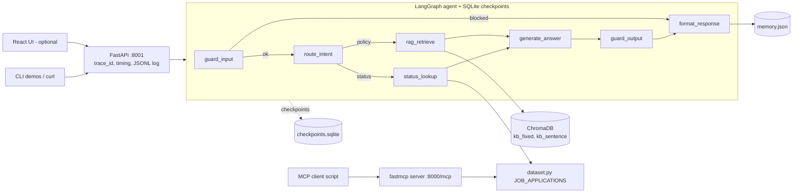

# Architecture

## 1. Overview


## 2. Agent state (`agent/state.py`, TypedDict)
| Field | Type | Set by | Meaning |
|---|---|---|---|
| `conversation_id` | str | API | Thread / memory key |
| `trace_id` | str | API | Per-request ID |
| `query` | str | API | Raw user text (never logged raw) |
| `masked_query` | str | `guard_input` | PII-masked text used everywhere after |
| `guardrail_flags` | list[str] | guards | e.g. `pii_masked`, `injection_blocked`, `ungrounded` |
| `blocked` | bool | `guard_input` | Skips to `format_response` |
| `history` | list[dict] | memory | Prior turns |
| `intent` | `"policy"` \| `"status"` | `route_intent` | Route |
| `record_id` | str \| None | `route_intent` | From query or memory |
| `retrieved_chunks` | list[dict] | `rag_retrieve` | text, doc_id, similarity |
| `top_score` | float | `rag_retrieve` | Top-1 cosine similarity |
| `tool_result` | dict \| None | `status_lookup` | Tool output |
| `answer` | str | `generate_answer` | Draft answer |
| `grounded` | bool | `guard_output` | Passed groundedness |
| `response` | dict | `format_response` | Schema-valid final payload |

## 3. Nodes
| Node | Responsibility | Reads | Writes | Failure behaviour |
|---|---|---|---|---|
| `guard_input` | Mask phone numbers; detect injection | `query` | `masked_query`, flags, `blocked` | Injection → blocked, safe reply |
| `route_intent` | Regex `APP-\d+`, keywords (status, application, escalate); fall back to last record id in history | `masked_query`, `history` | `intent`, `record_id` | Unknown → policy |
| `rag_retrieve` | Top-k from active collection | `masked_query` | chunks, `top_score` | Empty → score 0 |
| `status_lookup` | Call `check_job_application_status` | `record_id` | `tool_result` | Missing id → asks for ID |
| `generate_answer` | Mock LLM composes extractive answer from chunks / tool result | chunks, result | `answer` | – |
| `guard_output` | Refuse if `top_score < SIM_THRESHOLD` (policy route) | `top_score` | `grounded`, flags, fallback answer | Refusal text |
| `format_response` | Build response, validate JSON Schema, persist memory | all | `response` | Validation error raised |

## 4. Conditional edges
| After | Condition | Destination |
|---|---|---|
| `guard_input` | `blocked` | `format_response` |
| `guard_input` | else | `route_intent` |
| `route_intent` | `intent == "status"` | `status_lookup` |
| `route_intent` | `intent == "policy"` | `rag_retrieve` |

## 5. Request lifecycle
1. `POST /ask` → middleware creates `trace_id`, starts `perf_counter`.
2. Load history from `memory.json` for `conversation_id`.
3. Invoke graph with `thread_id = conversation_id`; SQLite saves state after each node.
4. `format_response` validates against `response_schema.json` and appends the turn to memory.
5. Middleware writes one JSONL line with masked text, route, grounded, latency, status code.

## 6. Components
| Component | Tech | Location |
|---|---|---|
| Config | constants, env flag | `config.py` |
| Dataset | seeded `random.Random` | `dataset.py` |
| KB | Markdown docs | `kb/` |
| Chunkers | fixed+overlap, sentence | `rag/chunking.py` |
| Vector store | ChromaDB persistent | `chroma_db/` |
| Embeddings | all-MiniLM-L6-v2 | `rag/index.py` |
| Retrieval / generation | cosine similarity, mock LLM | `rag/retrieve.py`, `rag/generate.py`, `agent/llm.py` |
| Agent | LangGraph | `agent/graph.py` |
| Guardrails | regex, thresholds | `agent/guardrails.py` |
| Memory | JSON file | `agent/memory.py`, `memory.json` |
| API | FastAPI + Pydantic | `api/` |
| MCP | fastmcp | `mcp_server/` |
| Resilience demos | RetryPolicy, wait_for | `resilience/` |
| Evaluation | mock judge | `eval/` |
| Frontend (optional) | React + Tailwind v4 | `frontend/` |

## 7. Cross-cutting design rules
- **Determinism:** seeded local RNG, mock LLM, fixed chunk parameters.
- **Single masking function** used for both the model input and the logs.
- **Single source of truth** for thresholds/paths/seed: `config.py`.
- **Tool reuse:** the same `check_job_application_status` function is called by the agent and the MCP server.
- **No global random state.**

## 8. Folder map
```
Recruitment/
├─ README.md prd.md plan.md ARCHITECTURE.md DECISIONS.md EVALUATION.md API.md
├─ RUNBOOK.md TESTING.md DEPLOYMENT.md FRONTEND.md CHANGELOG.md
├─ .agents/GEMINI.md
├─ config.py dataset.py requirements.txt Dockerfile (optional)
├─ kb/                 12+ policy docs
├─ rag/                chunking, index, retrieve, calibrate, generate, eval_retrieval
├─ agent/              state, tools, graph, memory, guardrails, llm, response_schema.json
├─ api/                main, models, logging_utils
├─ eval/               test_queries.json, triad.py
├─ mcp_server/         server.py, client.py
├─ resilience/         checkpoint_demo.py, timeout_retry_demo.py
├─ tests/              test_*.py
├─ transcripts/        tNN_*.txt
├─ logs/               requests.jsonl
└─ frontend/           React + Tailwind v4 (optional)
```

## 9. Ports & URLs
| Service | URL |
|---|---|
| FastAPI | `http://127.0.0.1:8001` (docs at `/docs`) |
| MCP | `http://127.0.0.1:8000/mcp` |
| Vite dev | `http://localhost:5173` |

## 10. Runtime artefacts (git-ignored)
`chroma_db/`, `checkpoints.sqlite`, `memory.json`, `.venv/`, `__pycache__/`.
