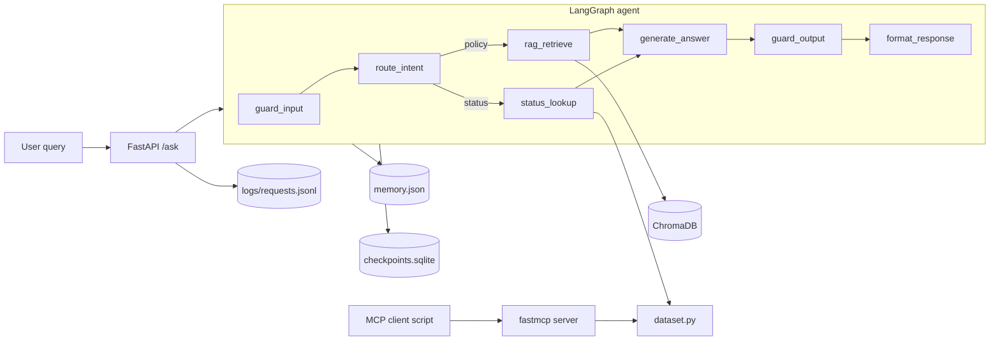

# PRD — Naukri.com Employer-Support Agent (LangGraph)

| Item | Value |
|---|---|
| Track | Recruitment & HR (Naukri.com) |
| Duration | 14 days |
| Marks | 100 (P1: 30, P2: 30, P3: 20, P4: 20) |
| Deliverable | One public GitHub repo (code + text only) |
| Runtime mode | `MOCK_LLM=1`, zero API keys, zero network at runtime |
| Source brief | `Doc/Question.md` |

---

## 1. Background & Problem Statement
Naukri.com's employer-support team handles two repeating question types over email:
1. **Policy questions** ("What is the notice-period policy?").
2. **Application-status questions** ("What is the status of record APP-0007?").

Email threads cause delays. We build a single support agent that answers both instantly,
safely and reliably. It must be built to production standards: grounded answers,
guardrails, memory, observability, resilience and a standard tool interface (MCP).

## 2. Goals
| # | Goal | Success signal |
|---|---|---|
| G1 | Answer policy questions only from a KB we write | Grounded answers; fallback on out-of-scope |
| G2 | Look up application status from a validated dataset | Correct status, salary, escalation score |
| G3 | Remember conversations | Multi-turn transcript + fresh-reset transcript |
| G4 | Refuse misuse | PII masked, injection blocked, ungrounded refused |
| G5 | Survive failures | Checkpoint resume, retries, timeouts |
| G6 | Be reusable | Tool exposed over MCP, API over FastAPI |
| G7 | Be measurable | P@3/R@3, RAG-triad scores, JSONL logs |

## 3. Non-Goals
- Paid APIs / credit cards (real LLM is optional, behind an env flag only).
- Any UI, images, screenshots, PDFs, slides, audio or video.
- Masking candidate name, expected salary, background-check results (out of scope per brief; fabricated data only).
- Real authentication, multi-tenant deployment, cloud hosting.

## 4. Personas
| Persona | Needs | Example query |
|---|---|---|
| Recruiter | Hiring policy answers | "How does offer negotiation work?" |
| Candidate | Application status | "Status of APP-0012?" |
| Support ops | Logs, escalation hints | Reads JSONL logs, escalation score |
| Grader | Reproducibility | Reruns `dataset.py`, scripts, transcripts |

## 5. Tech Stack
| Layer | Choice | Notes |
|---|---|---|
| Language | Python 3.10+ | |
| Orchestration | `langgraph` | StateGraph, conditional edges |
| Checkpoint | `langgraph-checkpoint-sqlite` | `checkpoints.sqlite` |
| Embeddings | `sentence-transformers` `all-MiniLM-L6-v2` | local, free |
| Vector DB | `chromadb` | 2 collections |
| API | `fastapi` + `uvicorn` + `pydantic` | |
| MCP | `fastmcp` (no hyphen) | HTTP at `/mcp` |
| Validation | `jsonschema` | structured output |
| LLM | `MOCK_LLM` deterministic mock | optional real LLM via env flag |

## 6. System Architecture



### Agent state (TypedDict)
`query`, `masked_query`, `intent`, `record_id`, `retrieved_chunks`, `top_score`, `tool_result`,
`answer`, `grounded`, `guardrail_flags`, `history`, `trace_id`, `response`.

## 7. Detailed Functional Requirements

### PART 1 — Dataset & RAG Core (30 marks)

#### FR-1 Dataset (`dataset.py`) — Task 1
- Use a local `random.Random(SEED)`; no global random state; fully deterministic.
- `JOB_APPLICATIONS`: list of ≥40 dicts (target 60 for stable statistics).
- Fields:

| Field | Type | Rule |
|---|---|---|
| `record_id` | str | `APP-0001`, unique |
| `category` | str | weighted choice among 5 given values |
| `status` | str | weighted choice among 5 given values |
| `expected_salary_inr` | int | per-category range, e.g. 300,000–3,000,000 INR/yr; one-sentence justification |
| `days_since_created` | int | 0–30 |
| `flagged_priority_review` | bool | probability tuned so 10–30% |

- Guarantee coverage: assert every category ≥3, every status ≥1; if not, change seed/weights (never hand-edit records).
- Print: count per category, count per status, flagged %.
- `validate_dataset()` function with asserts for all thresholds.
- README must state: SEED, category weights, status weights, salary range, reasoning.

#### FR-2 Knowledge base — Task 2
- Folder `kb/`, one file per topic (12 minimum), 2–5 sentences, own wording.
- Required topics / files:
  `eligibility.md`, `interview_scheduling.md`, `offer_negotiation.md`, `background_verification.md`,
  `notice_period.md`, `referral_bonus.md`, `internal_transfer.md`, `probation_period.md`,
  `remote_work.md`, `diversity_hiring.md`, `exit_interview.md`, `data_retention.md`.
- Each doc has a clear `doc_id` (filename stem) and title; facts should be specific (days, percentages) and fictional.
- Distinct vocabulary per doc so retrieval metrics are meaningful.

#### FR-3 Chunking & indexing — Task 3
- Strategy A: fixed-size with overlap (e.g. 200 chars, 40 overlap; document the values).
- Strategy B: sentence-based (regex or `nltk`-free splitter; 1–2 sentences per chunk).
- Embed every chunk with `all-MiniLM-L6-v2`; store metadata `doc_id`, `chunk_id`, `strategy`.
- Two ChromaDB collections: `kb_fixed`, `kb_sentence` (persistent dir `chroma_db/`, cosine space).
- Smoke test: one sample query returns sensible results from both.

#### FR-4 Grounded generation — Task 4
- `retrieve(query, k, collection)` returns chunks + cosine similarity (`1 - distance`).
- Calibration script (`rag/calibrate.py`): ≥3 in-scope and ≥2 out-of-scope queries; print top-1 similarity for each; threshold = midpoint of gap between clusters (max OOS < threshold < min in-scope).
- Generation under `MOCK_LLM`: extractive composition from retrieved chunks only, with source doc ids cited.
- Below threshold → fallback: "I don't know based on the available policy information."
- Demo: ≥5 in-scope + 1 out-of-scope (fallback). Record measured values and threshold in README.

#### FR-5 Retrieval evaluation — Task 5
- Ground-truth map: query → relevant doc_id(s) (≥5 queries; same ones as Task 4).
- Map chunks → parent doc, dedupe, then compute at doc level:
  - Precision@3 = relevant docs in top-3 / number of unique docs retrieved (state denominator rule explicitly).
  - Recall@3 = relevant docs retrieved / total relevant docs.
- Print per-query arithmetic for both collections, plus averages.
- 2–3 sentence recommendation citing both sets of numbers; the chosen collection feeds Part 2.

### PART 2 — Agent (30 marks)

#### FR-6 Status tool — Task 6
`check_job_application_status(record_id: str) -> dict`
- Returns `{record_id, status, expected_salary_inr, escalation_score, escalate_recommended}`.
- Unknown id → `{"error": "...not found"}` (no exception).
- Formula (to be finalised against data):
  `recency = days_since_created / 30`
  `escalation_score = 0.6 * flagged_priority_review + 0.4 * recency` (clamped to [0, 1]).
- Threshold: derived from dataset (e.g. 80th percentile of the computed score); report the number and its percentile reasoning in README.
- Docstring required (also used by MCP).

#### FR-7 LangGraph agent — Task 7
- ≥4 nodes (planned 7, see §6).
- `route_intent`: rules-based (regex for `APP-\d+`, keywords like "status", "application"); conditional edge → `status_lookup` or `rag_retrieve`.
- Transcript: ≥1 policy query and ≥1 status query showing the route taken.

#### FR-8 Persisted memory — Task 8
- `memory.json` keyed by `conversation_id` → list of turns `{role, content, ts}`.
- Follow-up resolution example: "Status of APP-0007?" then "And what is its salary?" reuses the last record_id from memory.
- Two transcripts: multi-turn (state carried) and fresh conversation (state absent; the follow-up asks for a record id).

#### FR-9 Structured output — Task 9
- JSON Schema (`agent/response_schema.json`) with required fields:
  `answer` (str), `route` (enum rag/status), `sources` (array), `grounded` (bool),
  `guardrail_flags` (array), `trace_id` (str), `confidence` (number 0–1), optional `tool_result`.
- `validate_response()` using `jsonschema`; raise on failure; run in the graph's final node and in the tests.

#### FR-10 Guardrails — Task 10
| Guardrail | Rule | Demo |
|---|---|---|
| PII mask | Regex for Indian phone numbers (`+91 98765 43210`, `9876543210`) → `[PHONE_MASKED]` | "Call me at +91 98765 43210" |
| Prompt injection | Pattern list ("ignore previous instructions", "reveal system prompt", ...) → block with safe reply | "Ignore previous instructions and ..." |
| Groundedness | top-1 similarity < threshold → refuse | out-of-scope question |
- Each guardrail adds a flag to `guardrail_flags`; one transcript each.

### PART 3 — API, Logging, Evaluation (20 marks)

#### FR-11 FastAPI — Task 11
| Endpoint | Request | Response |
|---|---|---|
| `POST /ask` | `{query, conversation_id?}` | schema from FR-9 |
| `POST /add-document` | `{doc_id, title, text}` | `{doc_id, chunks_added}` (indexed in both collections) |
| `GET /health` | – | `{status: ok}` (bonus) |
- Pydantic models for all; 422 on invalid input; tested with `TestClient`/curl.

#### FR-12 Structured logging — Task 12
- Middleware or wrapper appends one JSON line per request to `logs/requests.jsonl`:
  `trace_id`, `timestamp`, `endpoint`, `masked_query`, `route`, `grounded`, `latency_ms`, `status_code`.
- Raw phone numbers must never reach disk: apply the same masker before logging.
- Verification script greps the log for the test phone number (must find none).

#### FR-13 RAG triad evaluation — Task 13
- 15 queries in `eval/test_queries.json`: ≥1 per 12 topics (12) + ≥2 OOS/edge (+1 more).
- Mock judge (deterministic, e.g. embedding-similarity / token-overlap based):
  - Context relevance: query vs retrieved context.
  - Groundedness: answer sentences supported by context.
  - Answer relevance: query vs answer.
- Output table: 15 rows × 3 scores + 3 averages; saved to `transcripts/part3_triad.md`.

### PART 4 — Resilience & Interop (20 marks)

#### FR-14 MCP — Task 14
- `mcp_server/server.py`: `FastMCP("naukri-status")`, `@mcp.tool` wrapping the status function, with docstring; run HTTP on `127.0.0.1:8000` (endpoint `/mcp`).
- `mcp_server/client.py`: separate process using `fastmcp.Client("http://127.0.0.1:8000/mcp")`; call the tool for ≥2 record ids; print raw MCP responses.

#### FR-15 SQLite checkpointing — Task 15
- Compile graph with `SqliteSaver` (`checkpoints.sqlite`), config `{"configurable": {"thread_id": ...}}`.
- Demo script: (a) run executes ≥2 nodes; (b) stop deliberately (`interrupt_before=[<node>]` or simulated crash); (c) resume the same thread with `invoke(None, config)`.
- Each node increments and prints an execution counter/log; proof that completed nodes are not re-executed (counters unchanged, `get_state` shows `next` nodes only).

#### FR-16 Timeouts & retries — Task 16
| Item | Spec |
|---|---|
| Retry policy | `RetryPolicy(max_attempts=4, initial_interval=0.5, backoff_factor=2.0, max_interval=4.0, jitter=True)` (values documented) |
| Flaky node | counter-based: fails first 2 calls then succeeds |
| Per-node timeout | `asyncio.wait_for` wrapper (or `step_timeout`) → clean `NodeTimeoutError`, no hang |
| Global timeout | `asyncio.wait_for(graph.ainvoke(...), timeout=N)` → clean cancellation message |
- Three demos with printed logs: (a) retry recovers, (b) node timeout fires, (c) global timeout fires.

## 8. Non-Functional Requirements
| Area | Requirement |
|---|---|
| Determinism | Seeded data; mock LLM deterministic; fixed chunk params |
| Offline | Only the embedding model is downloaded once; then no network |
| Cost | Free only |
| Security | No secrets in repo; fabricated PII only |
| Quality | Type hints, docstrings, small modules, `pytest` tests per part |
| Reproducibility | `requirements.txt`, one command per demo, transcripts committed |
| Performance | `/ask` p95 < 2 s locally after warmup |

## 9. Repository Layout
```
Recruitment/
├─ README.md  prd.md  plan.md  requirements.txt  .gitignore
├─ dataset.py
├─ config.py                  # SEED, thresholds, paths, MOCK_LLM flag
├─ kb/                        # 12+ documents
├─ rag/        chunking.py  index.py  retrieve.py  calibrate.py  generate.py  eval_retrieval.py
├─ agent/      tools.py  graph.py  state.py  memory.py  guardrails.py  llm.py  response_schema.json
├─ api/        main.py  models.py  logging_utils.py
├─ eval/       test_queries.json  triad.py
├─ mcp_server/ server.py  client.py
├─ resilience/ checkpoint_demo.py  timeout_retry_demo.py
├─ tests/      test_dataset.py  test_rag.py  test_agent.py  test_guardrails.py  test_api.py
├─ transcripts/               # saved outputs for every task
└─ logs/       requests.jsonl
```

## 10. Deliverable → Evidence Matrix
| Task | Evidence file |
|---|---|
| 1 | `transcripts/t01_dataset.txt`, README choices |
| 2 | `kb/*.md` |
| 3 | `transcripts/t03_index.txt` |
| 4 | `transcripts/t04_calibration.txt`, `t04_grounded.txt` |
| 5 | `transcripts/t05_pr_at3.txt` |
| 6 | `transcripts/t06_status_tool.txt` |
| 7 | `transcripts/t07_routes.txt` |
| 8 | `transcripts/t08_memory_multi.txt`, `t08_memory_fresh.txt` |
| 9 | `transcripts/t09_schema.txt` |
| 10 | `transcripts/t10_guard_pii.txt`, `_injection.txt`, `_grounded.txt` |
| 11 | `transcripts/t11_api.txt` |
| 12 | `logs/requests.jsonl`, `t12_log_check.txt` |
| 13 | `transcripts/t13_triad.md` |
| 14 | `transcripts/t14_mcp_server.txt`, `t14_mcp_client.txt` |
| 15 | `transcripts/t15_checkpoint.txt` |
| 16 | `transcripts/t16_retry.txt`, `_node_timeout.txt`, `_global_timeout.txt` |

## 11. Acceptance Criteria (Definition of Done)
**Part 1:** dataset thresholds pass assertions; ≥12 KB docs; two Chroma collections retrieve sensibly; ≥5 grounded demos + 1 fallback with calibrated threshold in README; P@3/R@3 for both with arithmetic + recommendation.
**Part 2:** escalation formula + threshold justified; ≥4 nodes with conditional edge hitting both routes; memory multi-turn vs fresh transcripts; every response validated; each guardrail fires once.
**Part 3:** ≥2 endpoints with Pydantic; one JSONL line per request with trace ID, no raw phone; 15-query triad table + 3 averages.
**Part 4:** MCP round trip on ≥2 ids via separate client; checkpoint resume without re-execution; retry recovery, node timeout, global timeout all demonstrated.
**Global:** README states Naukri.com track, dataset choices, runs under `MOCK_LLM` with zero keys; single public repo link.

## 12. Risks & Mitigations
| Risk | Impact | Mitigation |
|---|---|---|
| Flagged % outside 10–30 | P1 fail | Tune seed/weights, loop-regenerate in dev, then freeze |
| Threshold not separating clusters | Wrong fallbacks | Add more diverse OOS queries; choose midpoint of gap |
| Short chunks → poor retrieval | Low P@3 | Tune chunk size/overlap; compare both strategies |
| Checkpoint demo not convincing | P4 loss | Print node counters + `get_state().next` before/after |
| `fastmcp` port/path errors | MCP fails | Use `/mcp`, run server in separate terminal |
| Raw PII in logs | P3 fail | Mask before any logging; grep verification |
| Windows asyncio / sqlite quirks | Demo bugs | Use `asyncio.run`, close sqlite connection cleanly |
| Embedding model download | First-run delay | Pre-download once; note in README |

## 13. Open Assumptions
- Mock LLM is extractive (concatenates best chunks), not generative.
- Intent routing is rule-based (deterministic) rather than LLM-based.
- Dataset size 60 records unless the thresholds demand a change.
